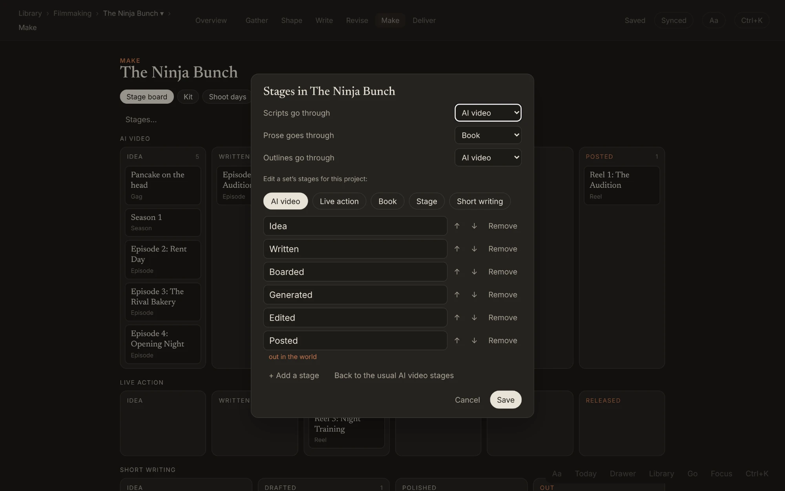

# Inkwell

**From a voice note to a finished reel.** Inkwell is a writing and production studio for solo storytellers making AI video: talk an idea out on a walk, shape it into a world and a script, break the script into shots and prompts, keep the takes that worked, and post it. One app on your computer and your Android phone, offline first, synced between them.

Most tools cover one step: a notes app for ideas, a screenwriting app for the script, a spreadsheet for shots, folders for renders. Inkwell keeps the whole road in one place, so a line you said on Tuesday is still linked to the shot it became on Friday.

- **Talk it out.** One voice button. Claude writes up what you said as an idea, a journal entry, or paragraphs and screenplay format right in your draft, and always keeps your exact words.
- **Build the world.** A bible of characters, places and props that every piece shares, from a 30-second gag to a season of episodes.
- **Write and structure.** A distraction-free editor, screenplays that format themselves, a plot grid with threads across every piece, and promises tracked until they pay off.
- **Make it.** Shots with codes that never change, still and video prompts written from your bible and style rules, renders with the best take starred, a storyboard you can play, and call sheets for live shoots.
- **Get it out.** Captions for YouTube, Instagram, Facebook, TikTok and X, subtitles and shot lists for Resolve, and read-and-comment links for collaborators.

Novels and other writing go through the same tabs, with their own stages. Claude helps when you ask and stays quiet while you write.

Live at https://laserbunny-coder.github.io/inkwell/

## From a voice note to a reel

Every screenshot here uses made-up sample data: **The Ninja Bunch**, an anime mockumentary musical told in short reels, about a family bakery that raises a troupe of hopeless ninjas. They're in dark mode; there's a light mode too. Shortcuts are written for Windows.

**1. Say it.** On a walk, tap the mic: "Kenji catches Grandpa on the roof at night, using the rolling pin for real. Scratch that, he sees it by accident. Note to self, ask Dana about the roof set." It lands on today's page, written up as an idea, with the note to self on its own line.


**2. Give it a home.** The Ninja Bunch is a world: a show with reels, gags, songs and a season of episodes, each at its own stage, with a bible every piece shares.


**3. Write the reel.** The script formats itself, with your own acts and sequences above the scene headings. Or talk the scene into the draft, and Claude writes it in screenplay format.


**4. Break it into shots.** Each scene knows which characters, places and props it uses. Each shot gets a code that never changes, prompts written from the bible's looks and the show's style rules, and its renders, with the best one starred.


**5. See it and ship it.** Play the storyboard as a rough animatic, then write captions for each platform and keep the links once it's posted.


## The whole tour

### Start here: four things

You only need four things to use Inkwell. Everything else is there when you reach for it.

| | Computer | Phone |
|---|---|---|
| **Today**, your daily page | `Ctrl + J` | Today in the bottom bar |
| **Talk**, one voice button | `Alt + C` (again to keep it) | the mic in the bottom bar, or long-press the Inkwell icon |
| **Every command** | `Ctrl + K` | ⋯ in the bottom bar |
| **A project's tabs** | `Alt + 0` to `Alt + 6` | the tabs along the top |

### Catch it

**Today's page** (`Ctrl + J`) is one page a day for anything: plans, ideas, research, links to pieces and pages, and #tags. A voice capture lands with a play button, the time, and a small chip naming the mode Claude wrote it up in (here, Idea). "Note to self" became its own line, and the words you really said are always kept.


**One voice button.** `Alt + C` (or the mic on the phone) records and lands where you are: on today's page, into the draft at the cursor, or on the page you're looking at, with a link line on today either way. The record screen says where it will go, with "Today instead" if you change your mind. Said out loud, "scratch that", "start again", "new paragraph" and "next scene" are carried out.


Voice modes (Idea, Journal, Scene, Text message, Email, or your own) are yours to edit: rename them, say what each does, and pick which Claude writes it. Tap a chip to see the same words in another mode, or word for word.

**Share into Inkwell** from Chrome, Instagram, Pinterest or any Android app. The link or picture lands on today with a snapshot (title, picture, a short summary) so it stays useful if the page goes away.

**The Drawer** holds ideas with no home yet. Tag a line `#drawer`, or choose "Into the drawer" in the day review. It never nags. When a world wants one, pull it in: it's linked there and stays in the drawer for anything else it could feed.


**Day review.** In the evening Inkwell can nudge you to review the day. Claude writes a few sentences on how it went, then offers a card per thread: send it to your task app, Keep thinking, Split or Let go. Nothing is sent until you tap.

### Every project is a world

**The Library** (`Ctrl + Shift + O`) holds every world, sorted into areas you make yourself (Writing › Novels › Working). "New" asks what you're making: one piece, a book series, a show, a collection, or a life project like a kitchen remodel, and you can change it any time.


**Overview** (`Alt + 0`) is a world's home: its logline, pieces by stage, and what to do next (things to file, promises not paid off, the next shoot day). The Ninja Bunch is a Show, so it talks in seasons and episodes, alongside its reels, gags and songs. Each piece has its own label and stage.


### The seven tabs

Every project has the same tabs across the top, hidden while you type. Hold `Alt` to see their numbers.

**Gather** (`Alt + 1`) is everything that came in about this world and isn't filed yet: lines from your daily pages, shares, voice captures, and drawer ideas that might fit. "File into…" puts each one where it belongs (a character's page, a piece), and "Go through" takes them one at a time.


**Shape** (`Alt + 2`) is the canon: the bible (pages inside pages, as deep as you like), arcs, timeline, relationships and promises. A piece gets an optional Develop page.


**Promises** list every ◇ promise the story makes, in this piece or any later one in the world, and where it pays off. One not paid off yet keeps a small dot.


**Write** (`Alt + 3`) lists the pieces to write in and opens them. Screenplays format themselves as you type (scene headings, action, characters, dialogue). Above the scene headings, a script can have its own levels: `# ` an act, `## ` a sequence, `### ` a named scene, each with a one-line summary only you see. Scene numbers appear only once you choose "Number the scenes (for production)", and never change after that (a scene added between 3 and 4 is 3A).


Prose is just the page. Notes sit in the margin beside the paragraph they belong to (`Ctrl + 2` shows or hides them; `Alt + N` adds one).


**Focus** (`Ctrl + .`) hides everything but the text: no tabs, no sections, no summaries, no tags.


**Walk and talk.** In a draft, the voice button writes what you said as paragraphs, one per beat (screenplay format in a script), at the cursor. Each paragraph keeps your exact words as its other version (`Alt + Down` flips), notes to self go in the margin, and a plain audio file works the same way ("Draft from a recording file…"). Typewriter mode keeps the line you're on still.

**Plot grid** (`Ctrl + Shift + G`) shows the story as a table, Rowling-style. Rows are the real acts, sequences, scenes, chapters or episodes; columns are threads (Kenji's courage, Grandpa's secret, Save the bakery) shared by every piece in the world. Cells are the same notes as in the margin. Drag a row to move that part of the manuscript, or drag a note to another cell.


**Revise** (`Alt + 4`) has continuity (posted pieces are canon, and Claude can check a piece against them and the bible) and readers' comments. While revising:

- **Fresh eyes** (`Ctrl + Shift + Y`) shows the draft as a reader would see it.
- **New draft from this one** (`Ctrl + K`) keeps a copy and lets you carry on; **Compare** (`Ctrl + Shift + X`) shows two drafts side by side.
- **Claude's notes** gives margin notes and a fix list when you ask, and "Talk this chapter over with Claude" opens a conversation about it.
- **Print** (`Ctrl + P`) gives clean pages to print or save as PDF.

**Make** (`Alt + 5`) is production. The stage board shows every piece by stage; drag a card to move it on. Each kind of piece goes through its own **stage set**: AI video (Idea, Written, Boarded, Generated, Edited, Posted), Live action (… Prepped, Shot, Edited, Released), Book (… Outlined, Drafted, Revised, Edited, Published), Stage and Short writing. Here the reels are AI video, Reel 3 is shot live on the bakery roof, and the song is short writing. The last stage always means out in the world.


"Stages…" picks which set scripts, prose and outlines go through in this project, and renames, adds, removes or reorders a set's stages. It says first what will move, and has Undo. One piece can go through another set from its ⋯ menu.



Inside a piece, **Production** (`Ctrl + Shift + S`) turns the script into what's needed to generate or shoot it. Each scene shows the bible elements it uses (found in its words), its production notes and its shots. Shot codes like `NB-R02-S01-01` never change, so file names and Resolve clips keep pointing at the right shot. Each shot has still and video prompts and its renders; the star marks the one that worked, and earlier prompts are never lost. Each shot says how it's made (Generated, From reference, or Live action), and each scene with lines says whether its voices are recorded, generated or both. "Download kit" zips a shot's prompts and reference pictures for PixAI, Seedance or ComfyUI.


The **storyboard** shows every shot in order with its starred still. "Play" runs them as a rough animatic.


**Kit** is the world's bible pages that are elements (characters, locations, props, wardrobe), each with reference pictures, a locked look and the few words that go into every prompt. **Shoot days** turn into a one-page call sheet (who's needed, locations, props, notes) to print, or send to your task app on that day at call time. A **To plan** list gathers the scenes that still need shooting or voices recorded, and **voice sessions** sit beside shoot days.


**Deliver** (`Alt + 6`) has files, share links and posting: a caption and the post's link for YouTube, Instagram, Facebook, TikTok and X (Claude drafts captions when asked), plus "Dialogue for subtitles (.srt)" and "Shot list for Resolve (.csv)". **Share a link to read and comment** gives readers a clean reading page; their comments show up in your margin and you can reply.


### Getting around

On a computer, a faint line at the top left says where you are and offers "‹ last place". `Ctrl + O` opens the **Go panel**: search anything, jump back to your last five places, go up the path, pick one of this project's tabs, or open Today, the Drawer, the Library or Tags. `Ctrl + O` then `Enter` flips back to where you just were.


`Ctrl + K` opens one menu for every command, grouped so it stays short.


**Tags** lists every #tag with how often and how recently it's used. Claude can sort them into groups and point out ones that look like the same thing; "Go through a tag" takes you through everything tagged, one at a time.


### On an Android phone

Inkwell installs to the home screen from Chrome and syncs with the computer. The bottom bar is always there (it hides while you type): **‹ Back**, named for where it goes; the place you're in, which opens the **Go sheet**; **Today**; the **mic**; and **⋯** for every command. The mic is also first on the rows above the keyboard, so you can talk without closing it.

<p>
  
  
  
</p>
<p>
  
  
  
</p>
<p>
  
</p>

### Light mode

`Ctrl + Shift + L` switches between dark and light.


## Claude, when you ask

- **Voice** write-ups in your modes, a `#tag` and links to anything you named, and spoken edits carried out.
- **Structure**: fill a thread's grid cells from the draft, and point out promises not paid off.
- **Production**: find the elements in every scene, suggest shots, write prompts from the scene, the elements' looks and the show's style rules, and draft captions.
- **Revision**: notes and a fix list, talking a chapter over, and continuity checks against canon.
- **The connector.** "Connect Claude to Inkwell" in `Ctrl + K` makes a private address to add in Claude (Settings, then Connectors, then Add custom connector). Claude can then read and search your worlds, pages and daily pages from any chat and add to them, always marked as Claude's. It never changes or deletes anything you wrote.

Every line, paragraph and page records who wrote it, you or Claude.

## Still landing

Being built right now, and not in the screenshots yet:

- **Meeting notes** from a recording: speakers, a summary, decisions and tasks.

## Shortcuts

All of them are also in `Ctrl + /`.

| Keys | What it does |
|---|---|
| `Ctrl + J` | Today's page (again goes back) |
| `Ctrl + Shift + J` | The Today panel beside what you're doing |
| `Alt + C` | Record; again to keep it (lands where you are) |
| `Ctrl + K` | Every command |
| `Ctrl + O` | Go panel (`Enter` flips back) |
| `Ctrl + Shift + O` | Library |
| `Alt + 0` to `Alt + 6` | Overview, Gather, Shape, Write, Revise, Make, Deliver |
| `Ctrl + .` | Focus |
| `Ctrl + 1` | Keep the outline open |
| `Ctrl + 2` | Notes beside the text |
| `Alt + N` | Add a note to this paragraph |
| `Ctrl + Shift + G` | Plot grid |
| `Ctrl + Shift + S` | Production |
| `Ctrl + Shift + Y` | Fresh eyes |
| `Ctrl + Shift + X` | Compare drafts |
| `Ctrl + P` | Print |
| `Ctrl + Shift + H` | Earlier versions of this chapter or page |
| `Ctrl + Shift + E` | Alternates for a word or paragraph; `Alt + Down` / `Alt + Up` flip between them |
| `Ctrl + Shift + P` | Words written per day, week or month |
| `Ctrl + Shift + F` | Search everything |
| `/` | Insert the time, a date, a link… |
| `Ctrl + ;` / `Ctrl + Shift + ;` | Today's date / the time |
| `[[` | Link to a page, day or chapter |
| `Ctrl + Shift + L` | Light or dark |
| `Alt + ]` / `Alt + [` | Wider / narrower page |

## How it's built

- [Tiptap](https://tiptap.dev) (on ProseMirror) is the editor. Plain JavaScript, built with [Vite](https://vite.dev).
- **Everything is an entry.** Worlds, pieces, acts, chapters, every paragraph, pages, lines, notes, threads, shots and shoot days are rows of one shape (`src/model.js`) with a stable id, tags and room for links and typed fields, so anything can link to anything. A world is `kind: 'world'` (its shape in `fields.shape`); a piece is `kind: 'project'` under a world or another piece, with `fields.type` (prose, script or outline), `fields.label` and `fields.stage`. `fields.by` and `fields.edited_by` record who wrote it.
- **Local first.** Each change is written at once to a write-ahead copy, then only the changed paragraphs go to the browser's database (IndexedDB), so a dying tab never loses text. It installs to the home screen and works offline (`public/sw.js`).
- **Sync** between devices runs on Supabase, shared with Daybook (the `writing_entries` table and the `inkwell` and `inkwell-mcp` functions live in the Daybook repo). Pictures and recordings go to a private storage bucket. A nightly backup goes to a private repo.
- Main parts: the daily page and pages (`src/notebook.js`, `src/outline.js`), capture and voice (`src/capture.js`, `src/voice.js`), the workflow tabs and Drawer (`src/pages.js`, `src/stages.js`), plot grid (`src/grid.js`), production (`src/production.js`, `src/prodview.js`), revision (`src/drafts.js`, `src/compare.js`, `src/review.js`), sharing (`src/sharelink.js`, `read.html`), getting around (`src/nav.js`).

## Run it

```
npm install
npm run dev
```

`npm test` builds the app and runs the browser checks in `tests/`, split over three machines on GitHub. Every push to `main` is tested and published to GitHub Pages by `.github/workflows/deploy.yml`.

To retake the screenshots after the app changes, run `node docs/screenshots/capture.mjs`. It fills a fresh local copy of the app with the Ninja Bunch sample data (sync goes to a stand-in, so no real account is touched) and saves new dark-mode screenshots: desktop at 2000px wide, phone at 780px. `ONLY=desktop-grid,phone-go` retakes just those.
