# Inkwell

A quiet, warm writing app for novels and screenplays, built to grow into a notebook and research vault.

Live at https://laserbunny-coder.github.io/inkwell/

## What it looks like

These are made-up books and notes, so you can see the app with something in it. They're shown in dark mode.

**Writing.** Just the page. Notes sit in the margin beside the paragraph they belong to (Ctrl + 2 shows or hides them). Links to research pages show in a warm orange.

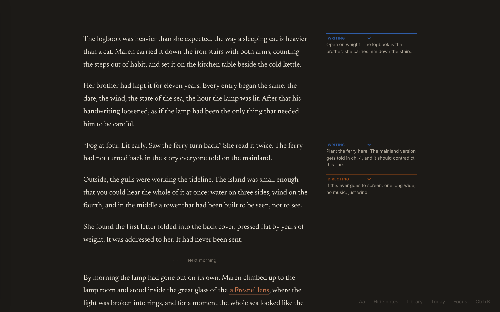

**Focus mode** (Ctrl + .) hides everything but the text.

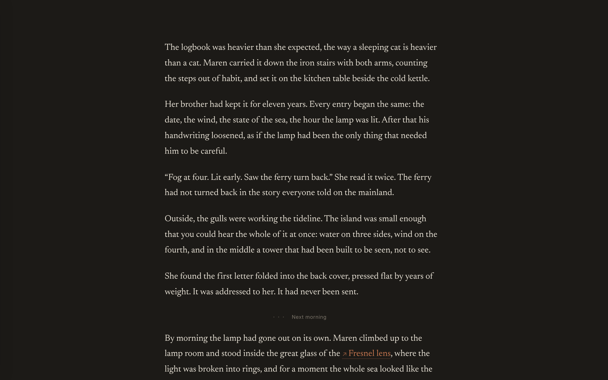

**The outline** slides in from the left edge: areas, books, acts, chapters, scenes and pages. Ctrl + 1 keeps it open. The small dots beside the text mark paragraphs that have notes.

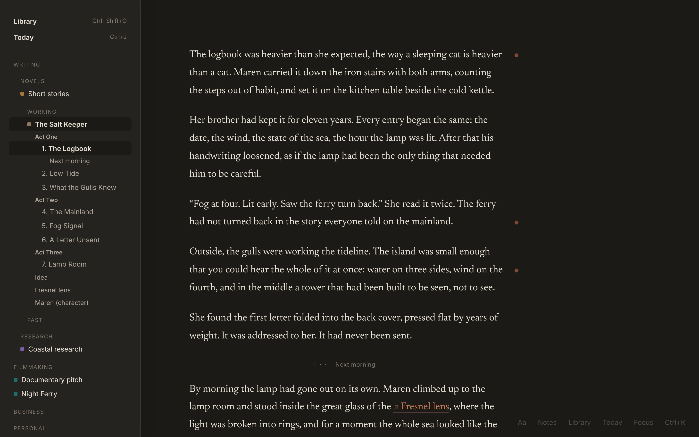

**Today's page** (Ctrl + J). One page a day for anything: plans, ideas, research, with links to chapters and pages and #tags. Earlier days scroll underneath.

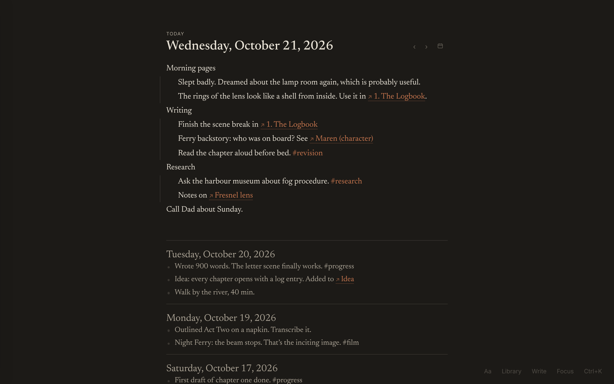

**The Library** (Ctrl + Shift + O) holds every novel, screenplay and notes collection, sorted into areas you make yourself.

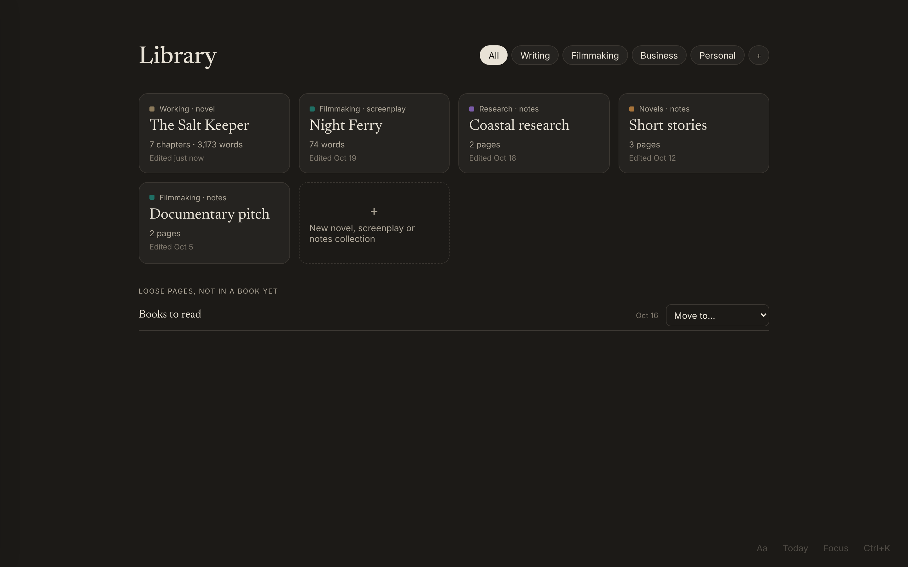

**A book's home** shows its chapters, its research pages and every line from your daily pages that mentions it.

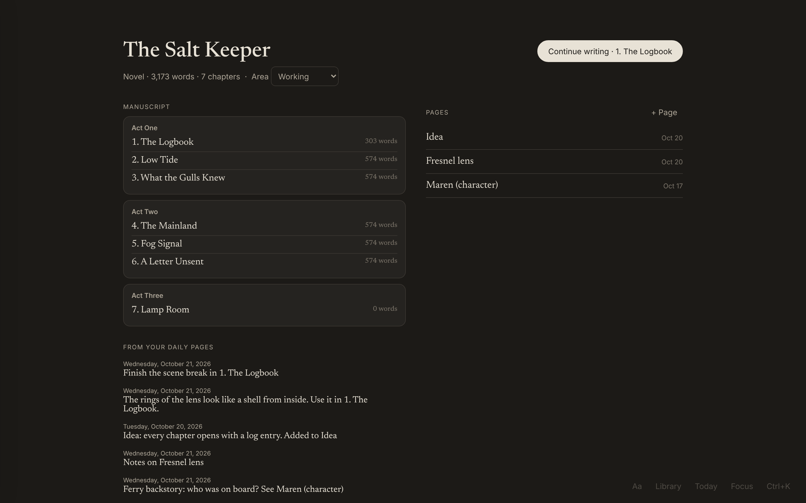

**Screenplays** are formatted as you type: scene headings, action, characters, dialogue.

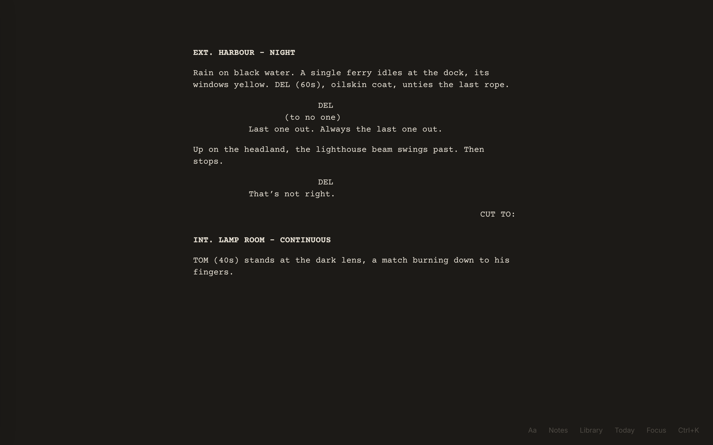

**One menu for everything** (Ctrl + K), and a **Progress** panel (Ctrl + Shift + P) with words written per day, week or month.

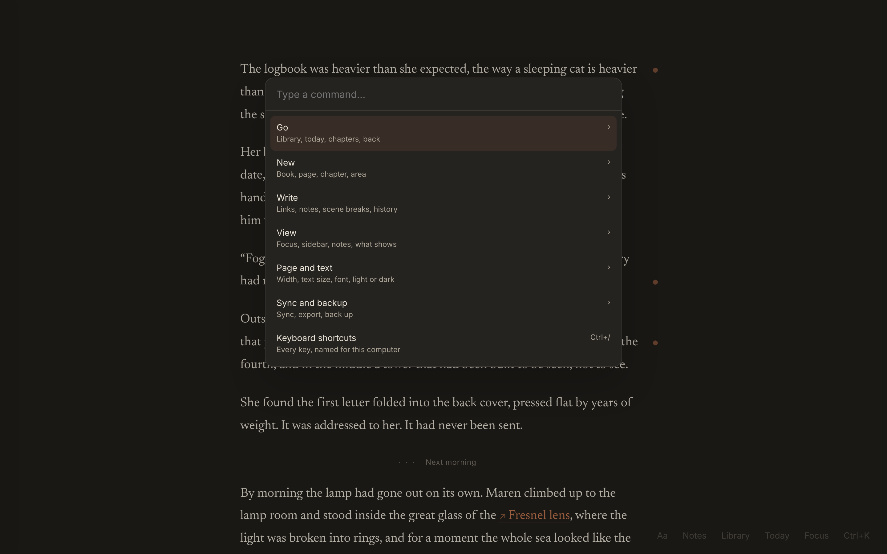

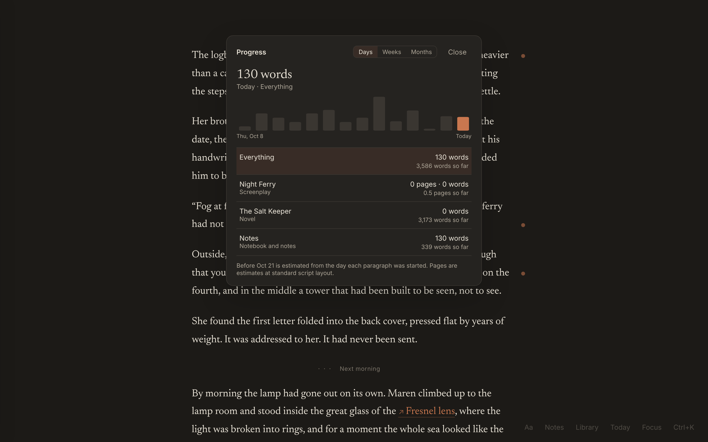

**Light mode** too, if you prefer it (Ctrl + Shift + L switches).

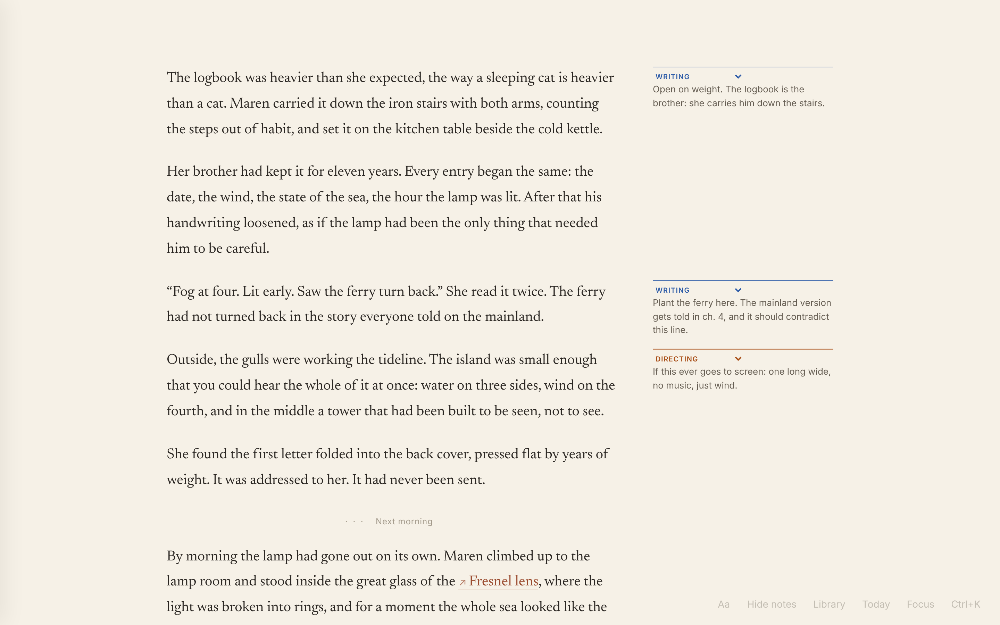

**On a phone** it installs to the home screen, works offline and syncs with the computer.

<p>
  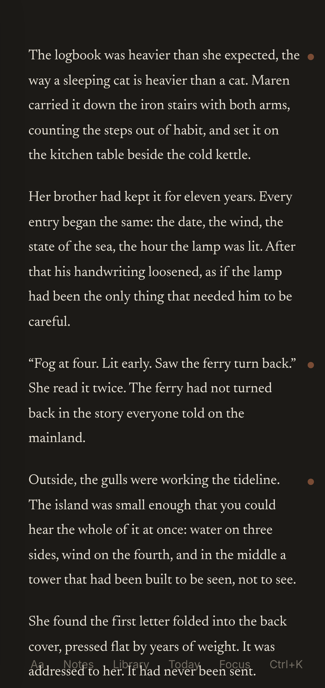
  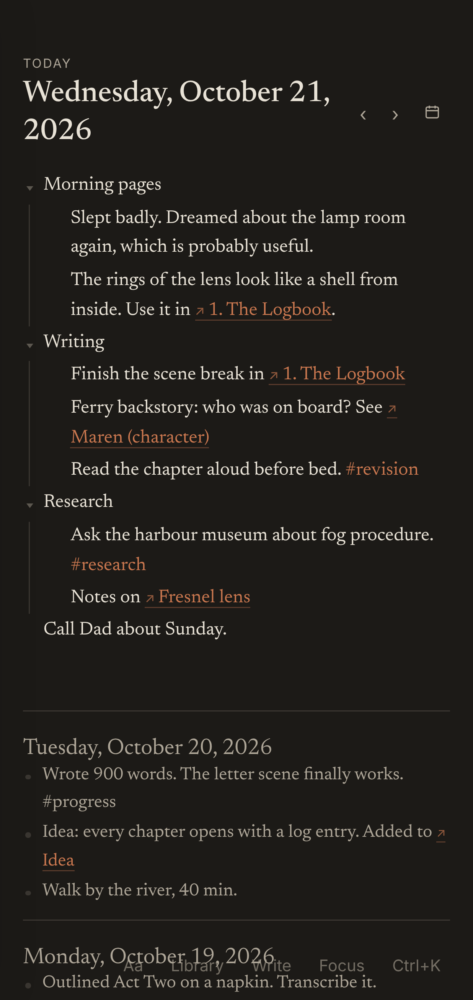
  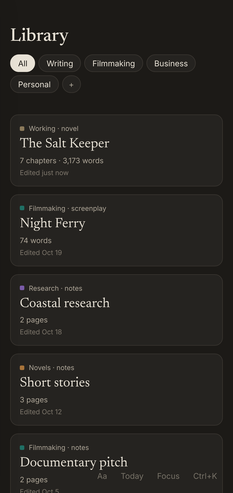
  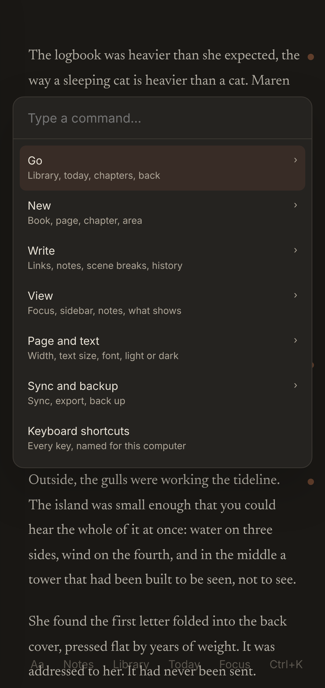
</p>

The screenshots are made by `node docs/screenshots/capture.mjs`, which fills a fresh local copy of the app with sample writing (sync off, so no real account is touched) and photographs it.

## Using it

Shortcuts are written for Windows. On a Mac, use ⌘ for Ctrl and ⌥ for Alt (and ⌘ + Shift + N for a note).

When you write, the screen shows only your text. Everything else is a hover or a keystroke away:

- Touch the **left edge** for the outline (acts, chapters, scenes). `Ctrl + 1` keeps it open. Double-click a name to rename it.
- Touch the **top edge** for the title, word count and save status.
- `Ctrl + K` opens one menu for every command.
- `Ctrl + 2` shows notes beside the text, each lined up with its paragraph. `Alt + N` adds a note to the paragraph you're in.
- `Ctrl + Shift + Enter` adds a scene break inside a chapter.
- `Ctrl + Shift + H` opens earlier versions of the chapter. A version is kept every time you pause typing.
- `Ctrl + Shift + L` switches light and dark.

## How it's built

- [Tiptap](https://tiptap.dev) (on ProseMirror) is the editor. Plain JavaScript, built with [Vite](https://vite.dev).
- **Everything is an entry.** Projects, acts, chapters, every paragraph, scene breaks and notes are all rows of one shape (`src/model.js`) with a stable id, tags (`#words` in the text) and room for links and typed fields. Daily-page lines and vault captures will use the same shape, so anything can link to anything.
- **Saving never loses text** (`src/chapter.js`). Each change is written at once to a local write-ahead copy, then only the changed paragraphs are saved to the browser's database (IndexedDB). If the tab dies mid-save, the write-ahead copy is picked up on the next open.
- **Past versions** live in their own store so they never slow down the draft.
- It installs to the home screen and works offline (`public/sw.js`).
- Export any chapter or the whole book as Markdown from `Ctrl + K`.

- Cloud sync between devices (Supabase, shared with Daybook) keeps the phone and the computer in step.

## Run it

```
npm install
npm run dev
```

`npm test` builds the app and runs the browser checks in `tests/run.mjs`.

Every push to `main` is tested and published to GitHub Pages by `.github/workflows/deploy.yml`.

## Notebook

Ctrl + J switches between the manuscript and today's page. Every day has a page, and you can make named pages too. Pages are nested lines: Tab nests, Shift+Tab lifts. Type `[[` to link a page, day or chapter (or make a new page), and `#tag` to tag a line. Each page lists the lines that link to it, and the shelves (left edge) list pages, recent days and tags. Every line is its own entry, so it syncs, links and can be found like a manuscript paragraph.

## Library

Everything lives in the Library (Ctrl + O jumps to anything by name; the left edge shows the whole tree). Areas can nest as deep as you like, e.g. Writing › Novels › Working. Each area holds books (novels) and notes collections. A new book starts with an Idea page. A book's home shows its manuscript, its pages and the lines from daily pages that link to it. Pages with no book yet are listed as loose pages until you move them. The daily page scrolls back through earlier days, and the app reopens wherever you last were.
