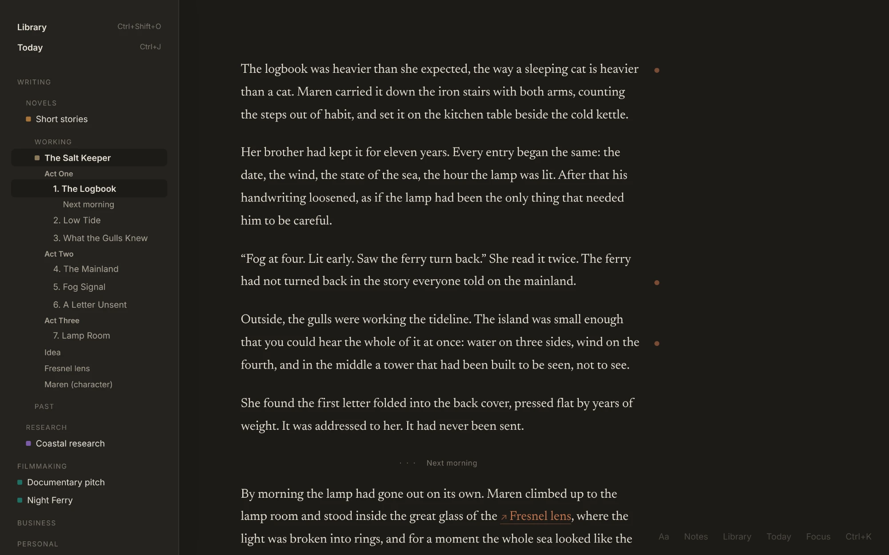
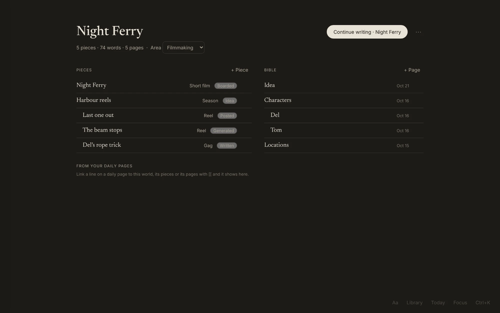
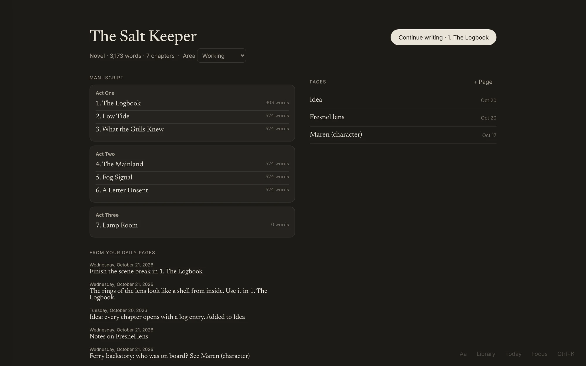
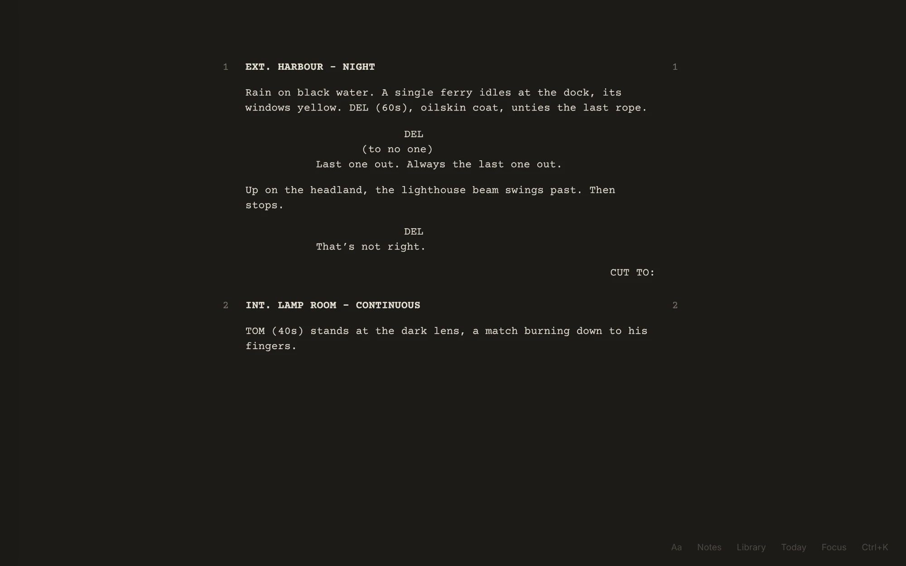
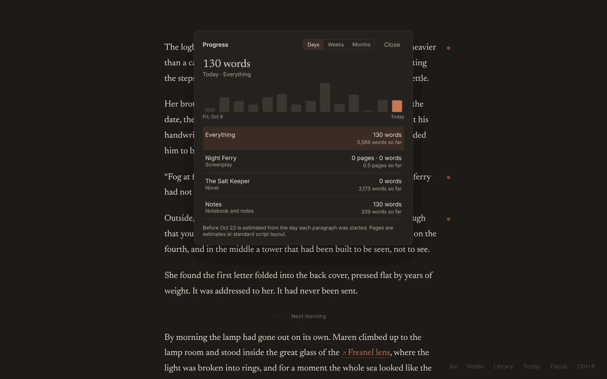
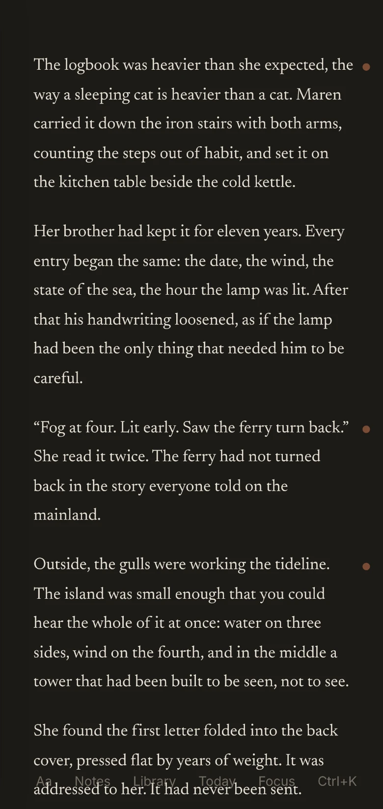
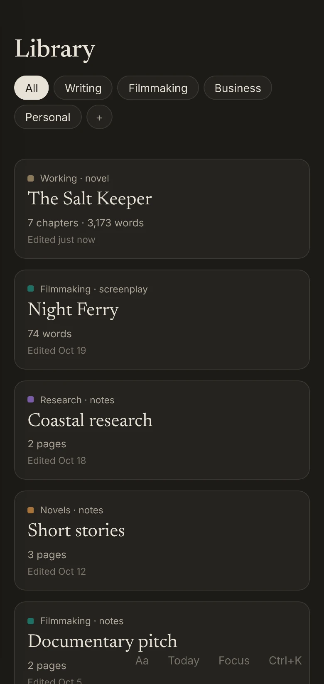
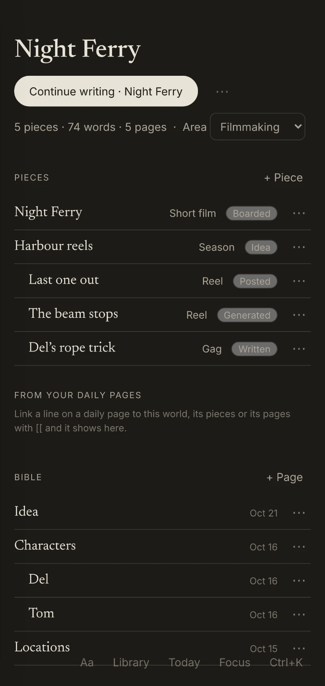
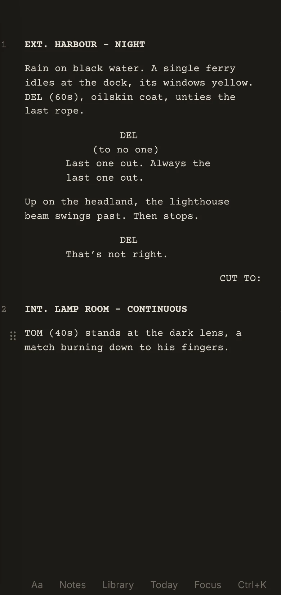
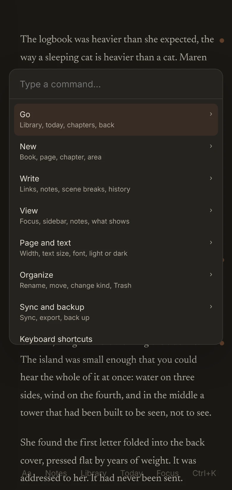

# Inkwell

A quiet, warm writing app for novels and screenplays, with a notebook and research vault built in, on a phone and a computer.

- Write with nothing on screen but your words. The outline, notes and menus appear only when you reach for them.
- Keep notes in the margin, lined up beside the paragraph they're about.
- Write screenplays that format themselves as you type.
- Keep one daily page for plans, ideas and research, and link any line to a chapter or page.
- Keep every story as a world: a bible of pages that nest, and pieces of any size inside it (a novel, a film, a season of episodes, a single gag), each with your own label and a stage.
- Every line and paragraph remembers who wrote it, you or Claude.
- Give a script stable scene numbers (3A, A1) once it heads into production.
- Let Claude read your writing and add to it from any chat, through Inkwell's own connector.
- See how many words you wrote each day, week or month.
- Install it on your phone. It works offline and syncs with your computer.

Live at https://laserbunny-coder.github.io/inkwell/

## A look around

These screenshots use made-up sample data. They're shown in dark mode, and there's a light mode too.

**Writing.** Just the page. Notes sit in the margin beside the paragraph they belong to (Ctrl + 2 shows or hides them). Links to research pages show in orange.


**Focus.** Ctrl + . hides everything but the text.


**The outline** slides in from the left edge: areas, books, acts, chapters, scenes and pages. Ctrl + 1 keeps it open. The small dots beside the text mark paragraphs that have notes.



**Today's page** (Ctrl + J). One page a day for anything, with links to chapters and pages and #tags. Earlier days scroll underneath.


**The Library** (Ctrl + Shift + O) holds every world, sorted into areas you make yourself.


**A world** holds its pieces, each with a label you choose (Short film, Season, Reel, Gag…) and a stage from Idea to Posted, and its bible: pages for characters, places and research, nested as deep as you like.



**A piece's home** shows its chapters, how it's written (prose, script or outline), its stage and every line from your daily pages that mentions it.



**Screenplays** are formatted as you type: scene headings, action, characters, dialogue. Scene numbers appear only once you choose "Number the scenes".



**One menu for everything.** Ctrl + K opens every command, grouped so it stays short.


**Progress** (Ctrl + Shift + P). Words written per day, week or month, for each book and for your notes.



**Light mode**, if you prefer it. Ctrl + Shift + L switches.


### On a phone

Inkwell installs to the home screen and syncs with the computer.

<p>
  
  
  
</p>
<p>
  
  
  
</p>

To retake these after the app changes, run `node docs/screenshots/capture.mjs`. It fills a fresh local copy of the app with the sample data (sync off, so no real account is touched) and saves new screenshots.

## Using it

Shortcuts are written for Windows. On a Mac, use ⌘ for Ctrl and ⌥ for Alt (and ⌘ + Shift + N for a note).

When you write, the screen shows only your text. Everything else is a hover or a keystroke away:

- Touch the **left edge** for the outline (acts, chapters, scenes). `Ctrl + 1` keeps it open. Double-click a name to rename it.
- Touch the **top edge** for the title, word count and save status.
- `Ctrl + K` opens one menu for every command.
- `Ctrl + 2` shows notes beside the text, each lined up with its paragraph. `Alt + N` adds a note to the paragraph you're in.
- `Ctrl + Shift + Enter` adds a scene break inside a chapter.
- `Ctrl + Shift + H` opens earlier versions of the chapter. A version is kept every time you pause typing.
- `Ctrl + Shift + L` switches light and dark.

### Worlds and pieces

Every project is a world. A world has a bible (pages that can hold pages, like Characters › Del) and pieces. A piece can be any size and can hold other pieces, so a Season holds its Episodes. Each piece is written as prose, a script or an outline, and carries a label you type yourself (earlier labels are offered) and a stage: Idea, Written, Boarded, Generated, Edited or Posted. "+ Piece" on a world's home adds one; the piece's `···` menu changes how it's written, its stage or where it lives. Nothing is ever deleted by changing these.

### Scene numbers

Scripts have no numbers while you draft. When a script is heading into production, choose "Number the scenes (for production)" from `Ctrl + K` or the piece's `···` menu. Each scene heading gets a number that never changes after that: a scene added between 3 and 4 becomes 3A, one before scene 1 becomes A1. "Show or hide scene numbers" in `Ctrl + K` hides them on screen, and focus mode hides them too. Turning numbering off only hides them; they come back as they were. Fountain export writes them as `#3A#`, and Fountain import reads them back.

### Who wrote what

Every line, paragraph and page records who first wrote it and who last changed it: you, or Claude (a Claude rewrite you keep, or anything Claude adds through the connector). Entries from before this was recorded count as yours.

### Claude connector

"Connect Claude to Inkwell" in `Ctrl + K` (signed in) makes a private address. In Claude, go to Settings, then Connectors, then Add custom connector, and paste it. Claude can then read your worlds, pieces, pages and daily pages from any chat, search them, and add lines, paragraphs, pages, worlds and pieces, all marked as Claude's. It never changes or deletes anything you wrote. Making a new address turns the old one off, and "Turn off Claude's access" in the same place removes it. The connector runs on the shared Supabase project (the `inkwell-mcp` function in the Daybook repo).

### Capture

- **Voice.** Long-press the Inkwell icon on Android and tap Capture. On a computer, `Alt + C` starts recording and `Alt + C` again keeps it (or `Ctrl + K`, "Capture an idea by voice"). One big button records; "Use a recording file instead" takes one from the phone's recorder app or the computer. The recording lands on today's page with a play button. When there's a connection Claude writes it up in the mode that fits (Idea, Journal, Scene, Text message, Email, or your own), and a small chip after the time says which. Tap the chip for the same words in another mode, word for word, or to copy the version showing; every version made is kept, with your edits. Said out loud, "scratch that", "start again", "new paragraph" and "next scene" are carried out, and "note to self…" asides go on their own line. Claude also adds one `#tag` and links to any film, show or book you named. Words you typed on the line meanwhile are never touched.
- **Modes** are the same ones Scribe uses, kept on your account, so a mode made in either app shows in both. Change them from `Ctrl + K`, "Your voice modes", or "Change your modes…" on a chip: rename, say what a mode does, pick which Claude writes it, add, delete.
- **Walk and talk.** In a chapter, `Alt + V` (or `/talk`, or Talk on the phone's writing bar) records into the draft. Claude writes what you said as paragraphs, a paragraph per beat (screenplay format in a script), where the caret was; each paragraph keeps what you really said as its other version (`Alt + Down` to flip), notes to self go in the margin, and the caret ends up after it all. Today's page keeps the recording, linked to the chapter. "Draft from a recording file…" does the same from a file. Claude never says anything while you write.
- **Typewriter mode** (Aa panel, or `Ctrl + K`) keeps the line you're on just above the middle of the screen and moves the page under it.
- Writing out needs the `OPENAI_API_KEY` secret in the Daybook repo; recordings over 10 minutes go to Deepgram when `DEEPGRAM_API_KEY` is there too. Until then recordings are kept and wait.
- **Share.** Share from Chrome, Instagram, Pinterest or any Android app, then pick Inkwell. The page, link or picture lands on today's page with an empty line under it for what it sparked. Links get a snapshot (title, picture, a one- or two-sentence summary) so they stay useful if the page goes away.
- **Watch and read lists.** On any page, `Ctrl + K`, "Make this page a watch list" (or read list). Type titles one per line, and once you move on Claude links each to its page, leaving your words and tags as you typed them.
- **Send to Daybook.** `Ctrl + K`, "Send this line to Daybook" puts the line in Daybook's Inbox as a task (without its #tags), with an "Open in Inkwell" link back to the line. Sending again updates the same task.
- **Day review.** At 9 pm (Pacific) Daybook gets a note, "Your day review", if today's page has something on it and hasn't been reviewed. Its link (`?review=<date>`) opens the day, and Claude writes three or four sentences on how it went, then a card for each thread: **Add to Daybook** (change the words and area, then send; it links back to the line), **Keep thinking** (goes on the "Still thinking about" page, with a link to the day, and comes back in later reviews as "Still on your mind?"), **Split** (a ramble into its parts) or **Let go**. Nothing goes to Daybook until you tap. Any day page: `Ctrl + K`, "Review the day". The review stays folded at the bottom of the day; hide it under Show, "Day review on day pages".

## How it's built

- [Tiptap](https://tiptap.dev) (on ProseMirror) is the editor. Plain JavaScript, built with [Vite](https://vite.dev).
- **Everything is an entry.** Worlds, pieces, acts, chapters, every paragraph, scene breaks, pages, lines and notes are all rows of one shape (`src/model.js`) with a stable id, tags (`#words` in the text) and room for links and typed fields, so anything can link to anything. A world is `kind: 'world'`; a piece is `kind: 'project'` whose parent is a world or another piece, with `fields.type` (how it's written), `fields.label` and `fields.stage`. Bible pages sit under the world. `fields.by` and `fields.edited_by` record authors (the account id, `'me'` before sign-in, or `'claude'`), and a numbered scene heading keeps its number in `fields.code`.
- **Books from before worlds** are brought up to date on first open after sync (`ensureWorlds` in `src/library.js`): each gets a world of the same name (id `wd-<book id>`, so every device makes the same one) and its pages move into the world's bible; a notes collection becomes a world itself. Nothing is deleted, and it's safe to run again.
- **Saving never loses text** (`src/chapter.js`). Each change is written at once to a local write-ahead copy, then only the changed paragraphs are saved to the browser's database (IndexedDB). If the tab dies mid-save, the write-ahead copy is picked up on the next open.
- **Past versions** live in their own store so they never slow down the draft.
- It installs to the home screen and works offline (`public/sw.js`).
- Export any chapter or the whole book as Markdown from `Ctrl + K`.

- Cloud sync between devices (Supabase, shared with Daybook) keeps the phone and the computer in step.

## Run it

```
npm install
npm run dev
```

`npm test` builds the app and runs the browser checks in `tests/run.mjs`.

Every push to `main` is tested and published to GitHub Pages by `.github/workflows/deploy.yml`.

## Notebook

Ctrl + J switches between the manuscript and today's page. Every day has a page, and you can make named pages too. Pages are nested lines: Tab nests, Shift+Tab lifts. Type `[[` to link a page, day or chapter (or make a new page), and `#tag` to tag a line. Each page lists the lines that link to it, and the shelves (left edge) list pages, recent days and tags. Every line is its own entry, so it syncs, links and can be found like a manuscript paragraph.

## Library

Everything lives in the Library (Ctrl + O jumps to anything by name; the left edge shows the whole tree). Areas can nest as deep as you like, e.g. Writing › Novels › Working. Each area holds worlds. A new world starts with an Idea page. A world's home shows its pieces, its bible and the lines from daily pages that link to it. Pages that aren't in a world yet are listed as loose pages until you move them. The daily page scrolls back through earlier days, and the app reopens wherever you last were.
